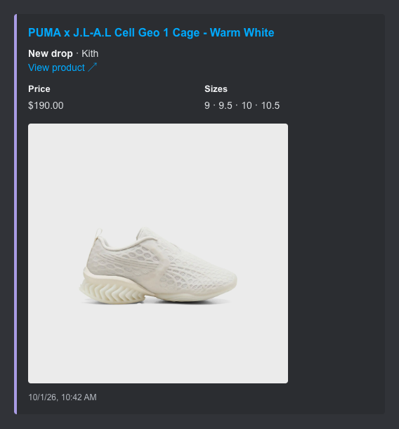
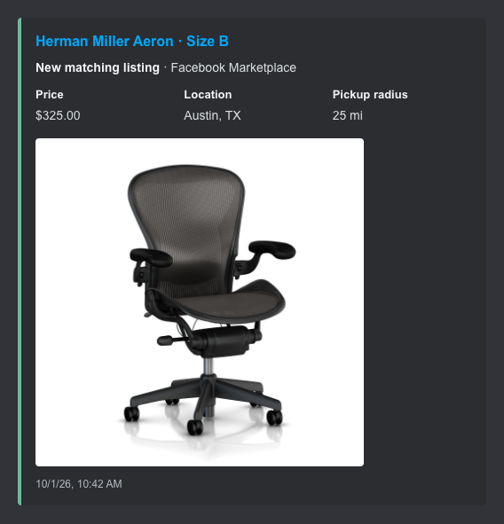
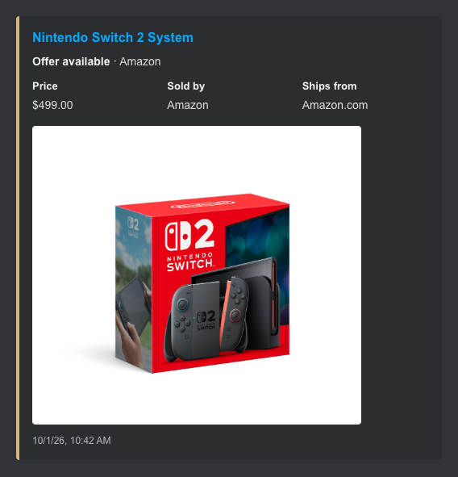
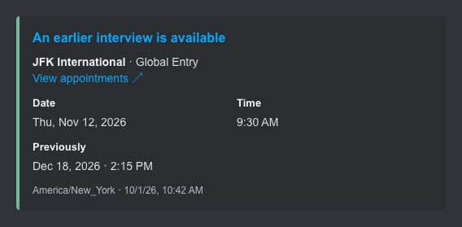
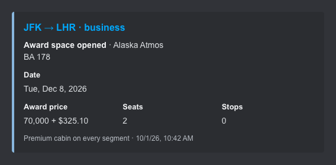
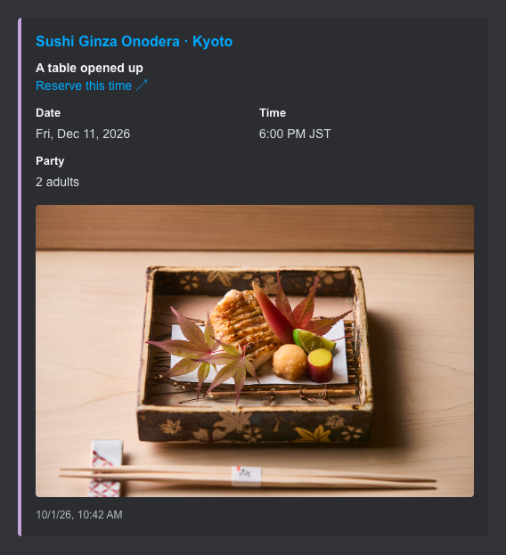
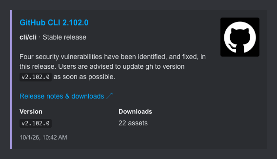
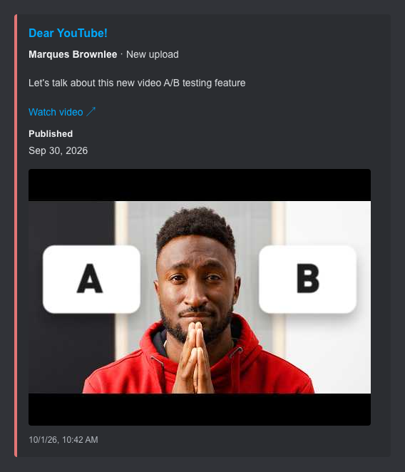
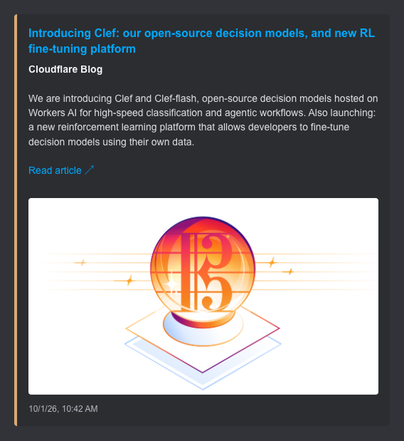
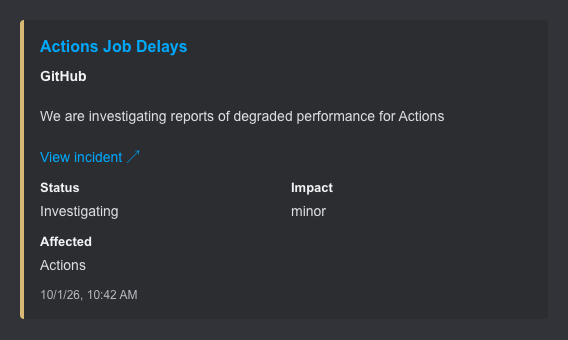

# monitors

Drops, deals, openings, and updates. Built with [monitord](https://github.com/saucesteals/monitord).

## Using an agent

Share this collection with your agent, tell it what to watch, and choose where alerts should go. Your agent can read the monitor’s README, customize its configuration, and run it with [monitord](https://github.com/saucesteals/monitord).

## SDK compatibility

All 13 examples build and pass `go vet` with these upstream versions (checked 2026-10-27):

- monitord: `v0.0.0-20261022022052-57d2a46c9343`
- Shop (Amazon and Marketplace): `v0.0.0-20261002000718-1a7a960631f5`

Apple Store, OpenTable and award-seats use monitord's `catalog/httpx` with standard `net/http` types. The SDK supplies Mimic and its browser profile; the examples do not pin a separate Mimic version or override the browser User-Agent. Other examples use standard HTTP or the Shop SDK.

Build compatibility does not guarantee a third-party endpoint remains available. Configure an example and run `monitord test` before deploying it; this checks a poll without sending alerts or saving state.

## Shopping

- **[Limited drops](commerce/shopify/README.md)** — Collabs, your size, restocks, price drops. · [code](commerce/shopify/source.go)
- **[Marketplace](commerce/marketplace/README.md)** — Local finds by query, radius, and budget. · [code](commerce/marketplace/source.go)
- **[Amazon](commerce/amazon/README.md)** — Seller + shipper + price rules. · [code](commerce/amazon/source.go)
- **[Apple Store](commerce/apple-store/README.md)** — Pickup restocks by part number, location, and store. · [code](commerce/apple-store/source.go)

## Travel & dining

- **[Global Entry](travel/global-entry/README.md)** — Earlier interviews before your deadline. · [code](travel/global-entry/source.go)
- **[Award seats](travel/award-seats/README.md)** — Premium cabins, enough seats, fewer points. · [code](travel/award-seats/source.go)
- **[OpenTable](dining/opentable/README.md)** — Restaurant openings by date, party, and dinner window. · [code](dining/opentable/source.go)
- **[Reservations](dining/tablecheck/README.md)** — Your restaurant, party, and exact seating. · [code](dining/tablecheck/source.go)

## Feeds & updates

- **[GitHub](development/github-releases/README.md)** — Releases, prereleases, tag filters. · [code](development/github-releases/source.go)
- **[YouTube](media/youtube/README.md)** — Uploads from channels you follow. · [code](media/youtube/source.go)
- **[RSS & Atom](media/rss/README.md)** — Articles with title and category filters. · [code](media/rss/source.go)
- **[Statuspage](infrastructure/statuspage/README.md)** — Component incidents and resolutions. · [code](infrastructure/statuspage/source.go)

## Security

- **[CVE alerts](security/cve/README.md)** — Product, keyword, and reference matches; severity filters and revision alerts. · [code](security/cve/source.go)
